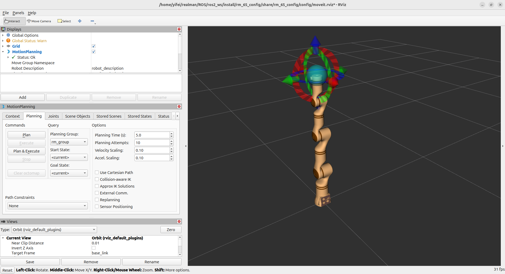
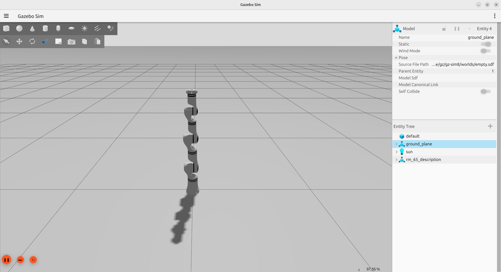

<div align="right">

[简体中文](README_CN.md)|[English](README.md)
 
</div>

<div align="center">

# RealMan Robot rm_bringup User Manual V1.7

RealMan Intelligent Technology (Beijing) Co., Ltd. 

Revision History:

|No.	  | Date   |	Comment |
| :---: | :----: | :---:   |
|V1.0	  | 2024-2-19 | Draft |
|V1.1	  | 2024-7-8 | Amend(Add GEN72 adapter files) |
|V1.2 	  | 2024-9-10 | Amend(Add ECO63 adapter files) |
|V1.3 	  | 2024-12-25 | Amend(Add 63, 65, 75, ECO65 six-axis force adapter files and 63, 65, 75, ECO63, ECO65 integrated six-axis force adapter files) |
|V1.4 	  | 2025-4-7 | Amend(Add GEN72_II adapter files) |
|V1.5 	  | 2025-11-13 | Amend(Add RML63_III adapter files) |
|V1.6 	  | 2026-4-16 | Amend(Add ECO62 and RX75 adapter files) |
|V1.7 	  | 2026-8-7 | Amend(Add unified launch entry) |

</div>

## Content
* 1.[rm_bringup Package Description](#rm_bringup_Package_Description)
* 2.[rm_bringup Package Use](#rm_bringup_Package_Use)
* 2.1[moveit2 Controlling Real Robotic Arm](#moveit2_Controlling_Real_Robotic_Arm)
* 2.2[Gazebo control of robotic arm](#Gazebo_control_of_robotic_arm)
* 3.[rm_bringup Package Architecture Description](#rm_bringup_Package_Architecture_Description)
* 3.1[Overview of Package Files](#Overview_of_Package_Files)
* 4.[rm_bringup Topic Description](#rm_bringup_Topic_Description)

## rm_bringup_Package_Description
rm_bringup is a function package for realizing the simultaneous running of multiple launch files. Using this package, a command can be used to launch complex functions combining multiple nodes. This package is introduced in detail in the following aspects.
* 1.Package use.
* 2.Package architecture description.
* 3.Package topic description.  
Through the introduction of the three parts, it can help you:
* 1.Understand the package use.
* 2.Familiar with the file structure and function of the package.
* 3.Familiar with the topic related to the package for easy development and use.
Source code address: https://github.com/RealManRobot/ros2_rm_robot.git。
## rm_bringup_Package_Use
### Unified launch entry
The recommended entry point is `rm_bringup.launch.py`. Select the robot model, end-link variant, and runtime mode with launch arguments. All existing model-specific launch commands remain supported.

```bash
# Simulation (retains the 6fb model name used by generation 3 and older generation 4 software)
ros2 launch rm_bringup rm_bringup.launch.py \
  arm_type:=65-6fb mode:=gazebo

# Real robot (generation 4 controller software > 1.0.5)
ros2 launch rm_bringup rm_bringup.launch.py \
  arm_type:=65-6f

# Note: Generation 4 controller software 1.0.6 and later names the former 6fb end link 6f.
```

Simulation does not connect to a controller and retains the `6fb` model name for this geometry. For a generation 3 robot or older generation 4 software, use `arm_type:=65-6fb`. `mode` defaults to `real` and `allow_trajectory_execution` defaults to `true`.

| Argument | Default | Description |
| :--- | :--- | :--- |
| `arm_type` | Required | Model including end-link version, e.g. `65`, `65-6f`, `eco63-6fb`; see the supported values below |
| `mode` | `real` | `real` or `gazebo` |
| `model` | `auto` | `auto/stl/glb`; `auto` prefers matching GLB assets and otherwise uses STL |
| `allow_trajectory_execution` | `true` | Whether MoveIt may execute trajectories; `false` keeps planning enabled without execution |
| `use_moveit` | `true` | Start MoveIt; when false, set `use_rviz:=false` as well |
| `use_rviz` | `true` | Start the MoveIt RViz process |
| `driver_config` | `auto` | Single-arm driver YAML in real mode; RX75 uses the left/right options |
| `left_driver_config` | `auto` | RX75 left-arm driver YAML |
| `right_driver_config` | `auto` | RX75 right-arm driver YAML |
| `follow` | `auto` | Real follow mode: `auto/true/false`; `auto` is `false` for all models; set `true` to select high-follow mode |
| `joint_states_topic` | `auto` | Only `auto` is currently supported; it selects the model/mode default |
| `start_gazebo` | `true` | Start Gazebo processes in gazebo mode |

Real mode accepts new generation 4 names, such as `arm_type:=eco63-6f mode:=real`.
The entry starts the driver and reads the API-reported generation through its existing
`get_robot_info_cmd/result` topics before choosing the model. Generation 4 `6f/6f-v`
inputs reuse existing `6fb/6fb-v` configurations; generation 3 retains the old 6F model.
No manual generation argument is required. Failed or missing information after 10 seconds
stops bringup before description, control and MoveIt are started; no generation is guessed.
Disconnected description and simulation entries retain their original
selection rules. Software versions above `1.0.5` change the name only, not ISF/ISFV geometry.

The following table applies to unified real bringup for the 10 families. Generation 4 new names apply when communication software is > `1.0.5`; older software keeps `6fb/6fb-v`. Bare families select the standard version:

| Model | Generation 3 arm_type values | Generation 4 arm_type values (new names) |
| :--- | :--- | :--- |
| `63` | `63`, `63-6f`, `63-6fb` | `63`, `63-6f`; also accepts `63-6fb` |
| `63_iii` | `63_iii`, `63_iii-6fb` | `63_iii`, `63_iii-6f`; also accepts `63_iii-6fb` |
| `65` | `65`, `65-6f`, `65-6fb` | `65`, `65-6f`; also accepts `65-6fb` |
| `75` | `75`, `75-6f`, `75-6fb` | `75`, `75-6f`; also accepts `75-6fb` |
| `eco62` | `eco62` | `eco62` |
| `eco63` | `eco63`, `eco63-6fb` | `eco63`, `eco63-6f`; also accepts `eco63-6fb` |
| `eco65` | `eco65`, `eco65-6f`, `eco65-6fb` | `eco65`, `eco65-6f`; also accepts `eco65-6fb` |
| `gen72` | `gen72` | `gen72` |
| `gen72_ii` | `gen72_ii` | `gen72_ii` |
| `rx75` | `rx75-6fb`, `rx75-6fb-v` | `rx75-6f`, `rx75-6f-v`; also accepts `rx75-6fb`, `rx75-6fb-v` |

Generation 3 `-6f` selects the original force-sensor geometry. Generation 4 `-6f` selects the existing integrated `-6fb` geometry.
Standalone display and Gazebo do not read controller generation and retain the original model names. Use `65-6fb`, rather than `65-6f`, to display or simulate the same integrated geometry.
Unsupported combinations are rejected, such as ECO62 with `6fb`. `allow_trajectory_execution`
defaults to `true`; set it to `false` when trajectory execution should be disabled.

The unified entry composes the generic launch files from `rm_driver`,
`rm_description`, `rm_control`, and `rm_gazebo` directly. Each component receives
the resolved complete `arm_type`, such as `65-6fb`. Driver/Control select the existing
family YAML, hardware code, and following default internally. The 42 historical
model-specific entries are thin compatibility wrappers; existing commands and
the RX75 `use_moveit_rviz` argument remain available. Gazebo intentionally
keeps the historical eight-second MoveIt delay in this structural migration;
controller-readiness sequencing will be implemented separately.

### Model selection

In `mode:=real`, the default `model:=auto` selects colored GLB for the 14 variants with
matching assets. TF and MoveIt use the same robot description. Select `model:=stl` for
the original STL model, or `model:=glb` to require GLB; a missing GLB variant fails
before nodes start.

In `mode:=gazebo`, the 14 combinations with GLB assets default to colored GLB in both Gazebo and RViz2; other models keep STL. Use `model:=stl` for the original meshes. Collision and physics stay unchanged.

### moveit2_Controlling_Real_Robotic_Arm
First, after configuring the environment and completing the connection, we can directly launch the node and run the launch.py file in the rm_bringup package through the following command.
```
rm@rm-desktop:~$ ros2 launch rm_bringup rm_<arm_type>_bringup.launch.py
```
In practice, the above <arm_type> needs to be replaced by the actual model of the robotic arm. This standard-model template supports 65, 63, 63_III, 75, eco62, eco63, eco65, gen72, and gen72_II. For RX75, use `rm_rx75_6fb_bringup.launch.py` for RX75-6FB and `rm_rx75_6fb_v_bringup.launch.py` for RX75-6FB-V.
The command to start the six-axis force version is currently available for 63, 65, 75, and eco65:
```
rm@rm-desktop:~$ ros2 launch rm_bringup rm_<arm_type>_6f_bringup.launch.py
```
The command to start the integrated six-axis force version is currently available for 63, 63_III, 65, 75, eco63, eco65, and rx75:
```
rm@rm-desktop:~$ ros2 launch rm_bringup rm_<arm_type>_6fb_bringup.launch.py
```
The command to start the vision-enabled integrated six-axis force version is currently only available for rx75:
```
rm@rm-desktop:~$ ros2 launch rm_bringup rm_<arm_type>_6fb_v_bringup.launch.py
```
For example, the launch command of 65 robotic arm:
```
rm@rm-desktop:~$ ros2 launch rm_bringup rm_65_bringup.launch.py
```
The following screen appears in the interface after a successful node launch.
  
The launch file launches the function of moveit2 to control the real robotic arm. Then, you can control the robotic arm movement by dragging the control ball. For details, please refer to "[rm_moveit2_config Detailed Description](https://github.com/RealManRobot/ros2_rm_robot/blob/main/rm_moveit2_config/README.md)".
### Gazebo_control_of_robotic_arm
We can run the launch.py file in the rm_bringup package through the following command, and directly launch the gzaebo simulation node.
```
rm@rm-desktop:~$ ros2 launch rm_bringup rm_<arm_type>_gazebo.launch.py
```
In practice, the above <arm_type> needs to be replaced by the actual model of the robotic arm. This standard-model template supports 65, 63, 63_III, 75, eco62, eco63, eco65, gen72, and gen72_II. For RX75, use `rm_rx75_6fb_gazebo.launch.py` for RX75-6FB and `rm_rx75_6fb_v_gazebo.launch.py` for RX75-6FB-V.

The command to start the six-axis force version is currently available for 63, 65, 75, and eco65:
```
rm@rm-desktop:~$ ros2 launch rm_bringup rm_<arm_type>_6f_gazebo.launch.py
```
The command to start the integrated six-axis force version is currently available for 63, 63_III, 65, 75, eco63, eco65, and rx75:
```
rm@rm-desktop:~$ ros2 launch rm_bringup rm_<arm_type>_6fb_gazebo.launch.py
``` 
The command to start the vision-enabled integrated six-axis force version is currently only available for rx75:
```
rm@rm-desktop:~$ ros2 launch rm_bringup rm_<arm_type>_6fb_v_gazebo.launch.py
```
For example, the launch command of 65 robotic arm:
```
rm@rm-desktop:~$ ros2 launch rm_bringup rm_65_gazebo.launch.py
```
The following screen appears in the interface after a successful node launch.

Then, we use the following command to launch moveit2 to control the simulation robot arm in Gazebo.

## rm_bringup_Package_Architecture_Description
### Overview_of_Package_Files
The current rm_bringup package is composed of the following files.
```
├── CMakeLists.txt                     # compilation rule file
├── doc                                # Supporting documents,pictures
│   ├── rm_bringup1.png                # pictures1
│   ├── rm_bringup2.png                # pictures2
│   └── rm_bringup3.png                # pictures3
├── launch
│   ├── rm_bringup.launch.py            # unified entry for every supported model, variant, and runtime mode
│   ├── rm_63_6f_bringup.launch.py     # 63 arm six-axis force moveit2 launch file
│   ├── rm_63_6f_gazebo.launch.py      # 63 arm six-axis force gazebo launch file
│   ├── rm_63_6fb_bringup.launch.py    # 63 arm integrated six-axis force moveit2 launch file
│   ├── rm_63_6fb_gazebo.launch.py     # 63 arm integrated six-axis force gazebo launch file
│   ├── rm_63_bringup.launch.py        # 63 arm moveit2 launch file
│   ├── rm_63_gazebo.launch.py         # 63 arm gazebo launch file
│   ├── rm_63_III_bringup.launch.py    # 63_III arm moveit2 launch file
│   ├── rm_63_III_gazebo.launch.py     # 63_III arm gazebo launch file
│   ├── rm_63_III_6fb_bringup.launch.py # 63_III arm integrated six-axis force moveit2 launch file
│   ├── rm_63_III_6fb_gazebo.launch.py  # 63_III arm integrated six-axis force gazebo launch file
│   ├── rm_65_6f_bringup.launch.py     # 65 arm six-axis force moveit2 launch file
│   ├── rm_65_6f_gazebo.launch.py      # 65 arm six-axis force gazebo launch file
│   ├── rm_65_6fb_bringup.launch.py    # 65 arm integrated six-axis force moveit2 launch file
│   ├── rm_65_6fb_gazebo.launch.py     # 65 arm integrated six-axis force gazebo launch file
│   ├── rm_65_bringup.launch.py        # 65 arm moveit2 launch file
│   ├── rm_65_gazebo.launch.py         # 65 arm gazebo launch file
│   ├── rm_75_6f_bringup.launch.py     # 75 arm six-axis force moveit2 launch file
│   ├── rm_75_6f_gazebo.launch.py      # 75 arm six-axis force gazebo launch file
│   ├── rm_75_6fb_bringup.launch.py    # 75 arm integrated six-axis force moveit2 launch file
│   ├── rm_75_6fb_gazebo.launch.py     # 75 arm integrated six-axis force gazebo launch file
│   ├── rm_75_bringup.launch.py        # 75 arm moveit2 launch file
│   ├── rm_75_gazebo.launch.py         # 75 arm gazebo launch file
│   ├── rm_eco62_bringup.launch.py     # eco62 arm moveit2 launch file
│   ├── rm_eco62_gazebo.launch.py      # eco62 arm gazebo launch file
│   ├── rm_eco63_6fb_bringup.launch.py # eco63 arm integrated six-axis force moveit2 launch file
│   ├── rm_eco63_6fb_gazebo.launch.py  # eco63 arm integrated six-axis force gazebo launch file
│   ├── rm_eco63_bringup.launch.py     # eco63 arm moveit2 launch file
│   ├── rm_eco63_gazebo.launch.py      # eco63 arm gazebo launch file
│   ├── rm_eco65_6f_bringup.launch.py  # eco65 arm six-axis force moveit2 launch file
│   ├── rm_eco65_6f_gazebo.launch.py   # eco65 arm six-axis force gazebo launch file
│   ├── rm_eco65_6fb_bringup.launch.py # eco65 arm integrated six-axis force moveit2 launch file
│   ├── rm_eco65_6fb_gazebo.launch.py  # eco65 arm integrated six-axis force gazebo launch file
│   ├── rm_eco65_bringup.launch.py     # eco65 arm moveit2 launch file
│   ├── rm_eco65_gazebo.launch.py      # eco65 arm gazebo launch file
│   ├── rm_gen72_bringup.launch.py     # gen72 arm moveit2 launch file
│   ├── rm_gen72_II_bringup.launch.py  # gen72_II arm moveit2 launch file
│   ├── rm_gen72_gazebo.launch.py      # gen72 arm gazebo launch file
│   ├── rm_gen72_II_gazebo.launch.py   # gen72_II arm gazebo launch file
│   ├── rm_rx75_6fb_bringup.launch.py  # RX75-6FB dual-arm moveit2 launch file
│   ├── rm_rx75_6fb_gazebo.launch.py   # RX75-6FB dual-arm gazebo launch file
│   ├── rm_rx75_6fb_v_bringup.launch.py # RX75-6FB-V dual-arm moveit2 launch file
│   └── rm_rx75_6fb_v_gazebo.launch.py  # RX75-6FB-V dual-arm gazebo launch file
├── rm_bringup                         # Python modules used by the unified entry
│   ├── __init__.py                      # Python package marker
│   ├── legacy_bringup.py                # compatibility-wrapper factory for the 42 legacy entries
│   ├── real_moveit.py                   # GLB MoveIt nodes for real-robot bringup
│   └── variant_catalog.py               # complete arm_type catalog, hardware profiles, and component mapping
├── package.xml
├── README_CN.md                  
└── README.md                           
```
## rm_bringup_Topic_Description
This package currently does not have its topic. It is mainly to call other packages. For the topics related to moveit2, please refer to "[rm_moveit2_config Detailed Description](https://github.com/RealManRobot/ros2_rm_robot/blob/main/rm_moveit2_config/README.md)".
