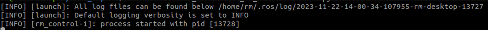

<div align="right">

[简体中文](README_CN.md)|[English](README.md)

</div>

<div align="center">

# RealMan Robot rm_control User Manual V1.4

RealMan Intelligent Technology (Beijing) Co., Ltd.

Revision History:

|No.	  | Date   |	Comment |
| :---: | :----: | :---:   |
|V1.0	  | 2024-2-19 | Draft |
|V1.1	  | 2024-7-3 | Amend(Add GEN72 related adapter files) |
|V1.2   | 2024-9-10 | Amend(Add ECO63 related adapter files) |
|V1.3   | 2026-4-16 | Amend(Add ECO62 and RX75 related adapter files) |
|V1.4   | 2026-8-13 | Amend(Add the unified control launch entry, follow override, and model-specific compatibility wrappers) |
</div>

## Launch examples

After building and sourcing the workspace, for an RM65 with integrated force sensing:

```bash
# Start trajectory control (generation 3 and 4 both use the base model)
ros2 launch rm_control rm_control.launch.py \
  arm_type:=65

# Note: Generation 4 software 1.0.6 and later names the former 6fb end link 6f.
# rm_driver and rm_control only need a base model, such as 63, 65, 75, eco63 or eco65.
# The naming difference does not change these launch arguments.
```

This package is part of the real-robot control chain; Gazebo uses simulation controllers. `arm_type` selects the base-family configuration. Start `rm_driver` first. See the [generation-specific model table](../rm_bringup/README.md#unified-launch-entry).

## Content
* 1.[rm_control Package Description](#rm_control_Package_Description)
* 2.[rm_control Package Function](#rm_control_Package_Function)
* 2.1[Basic use of the package](#Basic_use_of_the_package)
* 2.2[Advanced use of the package](#Advanced_use_of_the_package)
* 3.[rm_control Package Architecture Description](#rm_control_Package_Architecture_Description)
* 3.1[Overview of Package Files](#Overview_of_Package_Files)
* 4.[rm_control Topic Description](#rm_control_Topic_Description)

## rm_control_Package_Description
rm_control is a function package for realizing the moveit2 control of a real robotic arm. The package is mainly used to further subdivide the path points planned by moveit2, and give the subdivided path points to rm_driver in a through-transmission way to realize the planning and running of the robotic arm. This package is introduced in detail in the following aspects.
* 1.Package use.
* 2.Package architecture description.
* 3.Package topic description.
Through the introduction of the three parts, it can help you:
* 1.Understand the package use.
* 2.Familiar with the file structure and function of the package.
* 3.Familiar with the topic related to the package for easy development and use.
Source code address: https://github.com/RealManRobot/ros2_rm_robot.git。
## rm_control_Package_Function
### Basic_use_of_the_package
The unified entry point is recommended:
```bash
ros2 launch rm_control rm_control.launch.py arm_type:=65
```

Unified launch arguments:

- `arm_type` (required): `63`, `63_iii`, `65`, `75`, `eco62`, `eco63`, `eco65`, `gen72`, `gen72_ii`, or `rx75`. Complete selectors such as `65-6fb`, `eco63-6fb`, and `rx75-6fb-v` are also supported; see the [complete model table](../rm_bringup/README.md#unified-launch-entry).
- `follow` (default: `auto`): accepts only `auto`, `true`, or `false`; `auto` selects low-follow mode (`false`) for all models; use `follow:=true` to select high-follow mode.

Selecting `rx75` creates both the `left_arm` and `right_arm` control nodes. The eight legacy model entry points (`63`, `65`, `75`, `eco62`, `eco63`, `eco65`, `gen72`, and `rx75`) are now compatibility wrappers, and their existing commands remain supported.

First, after configuring the environment and completing the connection, we can directly start the node and run the rm_control package.
```
rm@rm-desktop:~$ ros2 launch  rm_control rm_<arm_type>_control.launch.py
```
In practice, the above <arm_type> needs to be replaced by the actual model of the robotic arm. The available models of the robotic arm are 65, 63, eco65, eco63, eco62, 75, gen72, and rx75.
For example, the launch command of 65 robotic arm:
```
rm@rm-desktop:~$ ros2 launch  rm_control rm_65_control.launch.py
```
The following screen appears in the interface after successful node startup.

It does not play a role when the node of the package is launched alone. It needs to be combined with the rm_driver package and the relevant nodes of moveit2 to play a role. For details, please refer to the relevant content of "rm_moveit2_config Detailed Description".
### Advanced_use_of_the_package
The following mode is configured directly through the unified launch entry; editing a launch file and rebuilding the workspace are not required:

```bash
ros2 launch rm_control rm_control.launch.py arm_type:=65 follow:=true
```

`follow:=true` selects high-follow mode, while `follow:=false` selects low-follow mode. High-follow mode tracks the transmitted trajectory more closely and requires suitable transmission rate, velocity, and acceleration settings. Low-follow mode has a lower usage threshold, but points that cannot be reached in time may be discarded. The default and `follow:=auto` both select low-follow mode; use `follow:=true` to opt into high-follow mode.

The user-facing `arm_type` value is the canonical model string listed in the basic-use section. The numeric values `65`, `651`, `634`, `632`, `621`, `75`, and `72` are internal node-parameter mappings maintained by the unified launch file; they are not values that users should pass to the `arm_type` launch argument.
## rm_control_Package_Architecture_Description
### Overview_of_package_files
The current rm_control package is composed of the following files.
```
├── CMakeLists.txt                     # compilation rule file
├── doc
│   ├── rm_control1.png
│   └── rm_control2.png
├── include                            # dependency header file folder
│   └── rm_control
│       ├── cubicSpline.h              # cubic spline interpolation header file
│       └── rm_control.h               # rm_control header file
├── launch
│   ├── rm_control.launch.py           # unified control launch entry
│   ├── rm_63_control.launch.py        # 63 launch file
│   ├── rm_65_control.launch.py        # 65 launch file
│   ├── rm_75_control.launch.py        # 75 launch file
│   ├── rm_eco62_control.launch.py     # eco62 launch file
│   ├── rm_eco65_control.launch.py     # eco65 launch file
│   ├── rm_eco63_control.launch.py     # eco63 launch file
│   ├── rm_gen72_control.launch.py     # gen72 launch file
│   └── rm_rx75_control.launch.py      # RX75 launch file
├── package.xml                        # dependency declaration file
├── README_CN.md
├── README.md
└── src
    └── rm_control.cpp                 # code source file
```
## rm_control_Topic_Description
The following is the topic description of the package.
```
  Subscribers:
    /parameter_events: rcl_interfaces/msg/ParameterEvent
    /rm_driver/move_stop_cmd: std_msgs/msg/Empty
  Publishers:
    /parameter_events: rcl_interfaces/msg/ParameterEvent
    /rm_driver/movej_canfd_cmd: rm_ros_interfaces/msg/Jointpos
    /rosout: rcl_interfaces/msg/Log
  Service Servers:
    /rm_control/describe_parameters: rcl_interfaces/srv/DescribeParameters
    /rm_control/get_parameter_types: rcl_interfaces/srv/GetParameterTypes
    /rm_control/get_parameters: rcl_interfaces/srv/GetParameters
    /rm_control/list_parameters: rcl_interfaces/srv/ListParameters
    /rm_control/set_parameters: rcl_interfaces/srv/SetParameters
    /rm_control/set_parameters_atomically: rcl_interfaces/srv/SetParametersAtomically
  Service Clients:

  Action Servers:
    /rm_group_controller/follow_joint_trajectory: control_msgs/action/FollowJointTrajectory
  Action Clients:
```
The paths above show the root namespace used by single-arm models. For RX75, each control node applies its arm namespace: the corresponding interfaces are `/left_arm/rm_driver/move_stop_cmd`, `/left_arm/rm_driver/movej_canfd_cmd`, and `/left_arm/rm_group_controller/follow_joint_trajectory`, with equivalent `/right_arm/...` paths for the right arm.

We mainly focus on the following topics.
Publishers: represents its current published topic, the most important published topic is /rm_driver/movej_canfd_cmd, through which we publish the subdivided points to rm_driver node, and then rm_driver node gives the corresponding path to the robotic arm through the transmission way.
Action Servers: represents the action information it receives and publishes, `/rm_group_controller/follow_joint_trajectory` action as the bridge of communication between rm_control and moveit2, through which rm_control receives the path planned by moveit2, and rm_control further subdivides these paths from the above topic to rm_driver.
There are relatively few remaining topics and service use scenarios, so we do not introduce them in detail here, and you can learn by yourself.
