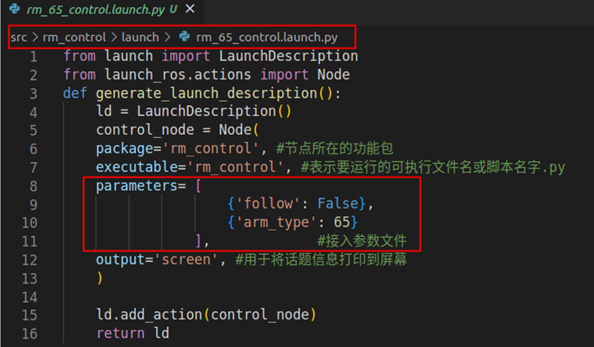

<div align="right">
 
[简体中文](README_CN.md)|[English](README.md)

</div>

<div align="center">

# 睿尔曼机器人rm_control使用说明书V1.4
 
睿尔曼智能科技（北京）有限公司 
文件修订记录：

| 版本号| 时间   | 备注  | 
| :---: | :-----: | :---: |
|V1.0    |2024-2-19  |拟制 |
|V1.1    |2024-7-3   |修订(添加GEN72相关适配文件) |
|V1.2    |2024-9-10  |修订(添加ECO63相关适配文件) |
|V1.3    |2026-4-16  |修订(添加ECO62、RX75相关适配文件) |
|V1.4    |2026-8-14  |修订(新增统一控制launch、follow覆盖参数和型号wrapper) |

</div>

## 启动示例

构建并 source 工作区后，以一体化六维力 RM65 为例：

```bash
# 启动真机轨迹控制节点（三、四代均使用基础型号）
ros2 launch rm_control rm_control.launch.py \
  arm_type:=65

# 注：四代控制器软件自 1.0.6 起将原 6fb 末端统一命名为 6f。
# rm_driver 和 rm_control 只需指定基础型号，如 63、65、75、eco63 或 eco65，无需末端后缀。
# 此处仅提示三、四代的命名差异，启动参数保持一致。
```

本包用于真机链路；Gazebo 使用仿真控制器。`arm_type` 按基础型号选择配置。 运行前需先启动 `rm_driver`。完整型号见[三、四代型号表](../rm_bringup/README_CN.md#统一启动入口)。

## 目录
* 1.[rm_control功能包说明](#rm_control功能包说明)
* 2.[rm_control功能包使用](#rm_control功能包使用)
* 2.1[功能包基础使用](#功能包基础使用)
* 2.2[功能包进阶使用](#功能包进阶使用)
* 3.[rm_control功能包架构说明](#rm_control功能包架构说明)
* 3.1[功能包文件总览](#功能包文件总览)
* 4.[rm_control话题说明](#rm_control话题说明)

## rm_control功能包说明
rm_control功能包为实现moveit2控制真实机械臂时所必须的一个功能包，该功能包的主要作用为将moveit2规划好的路径点进行进一步的细分，将细分后的路径点以透传的方式给到rm_driver，实现机械臂的规划运行。
* 1.功能包使用。
* 2.功能包架构说明。
* 3.功能包话题说明。  
通过这三部分内容的介绍可以帮助大家：
* 1.了解该功能包的使用。
* 2.熟悉功能包中的文件构成及作用。
* 3.熟悉功能包相关的话题，方便开发和使用
## rm_control功能包使用
### 功能包基础使用
推荐使用统一入口：

```bash
ros2 launch rm_control rm_control.launch.py arm_type:=65 follow:=auto
```

| 参数 | 默认值 | 说明 |
| :--- | :--- | :--- |
| `arm_type` | 无，必须指定 | 型号或带末端后缀的型号，例如 `65`、`65-6fb`、`rx75` |
| `follow` | `auto` | 透传跟随模式：`true` 为高跟随，`false` 为低跟随；`auto` 使用下方所述型号默认值 |

`arm_type` 必须指定，可选 `63`、`63_iii`、`65`、`75`、`eco62`、
`eco63`、`eco65`、`gen72`、`gen72_ii` 或 `rx75`。也支持 `65-6fb` 等后缀写法，
支持值见[型号表](../rm_bringup/README_CN.md)；控制型号编号和默认 follow 使用基础型号的配置。`follow` 仅接受
`auto`、`true` 或 `false`。`auto` 保留历史型号默认值：RM75、GEN72、
GEN72-II和RX75默认高跟随，其他型号默认低跟随。RX75会启动左右两个
带namespace的control节点。原有8个型号入口保留为兼容wrapper，无效
参数会在节点启动前报错。

首先配置好环境完成连接后我们可以通过以下命令直接启动节点，运行rm_control功能包。
```
rm@rm-desktop:~$ ros2 launch  rm_control rm_<arm_type>_control.launch.py
```
在实际使用时需要将以上的<arm_type>更换为实际的机械臂型号，可选择的机械臂型号有65、63、eco65、75、gen72。
例如65机械臂的启动命令：
```
rm@rm-desktop:~$ ros2 launch  rm_control rm_65_control.launch.py
```
节点启动成功后，将显示以下画面。

在单独启动该功能包的节点时并不发挥作用，需要结合rm_driver功能包和moveit2的相关节点一起使用才能发挥作用，详细请查看《rm_moveit2_config详解》相关内容。
### 功能包进阶使用
在rm_control功能包中也有一些参数可以进行配置，由于参数并不是很多，这边将参数直接在launch文件中进行了配置。

如上图所示第一个红框框出的位置为文件的路径，第二个框出的位置为当前可配置的参数。  
参数follow：代表当前透传使用的跟随模式，true:高跟随，false:低跟随。高跟随即机械臂运动方式与透传完全一致，需要根据透传的速率和机械臂的速度、加速度参数进行较详细的计算，使用门槛较高，但控制精细。低跟随即机械臂会基本根据透传速率和速度、加速度向透传点运动，若有来不及到达的点可能会有丢弃现象发生，使用门槛低，控制不太精细，但基本满足使用。  
参数arm_type：代表当前使用的机械臂型号，可以选择的参数有65（65系列）、651（eco65）、632（63系列）、75（75系列）、gen72（gen72系列）。  
再实际使用时，我们选择对应的launch文件启动时会自动选择正确的型号，若有特殊要求可在此处进行相应的参数修改，修改之后需要在工作空间目录下进行重新编译，之后修改的配置才会生效。  
在工作空间目录运行colcon build指令。
```
rm@rm-desktop: ~/ros2_ws$ colcon build
```
编译成功后可按如上指令进行功能包启动。
## rm_control功能包架构说明
### 功能包文件总览
当前rm_driver功能包的文件构成如下。
```
├── CMakeLists.txt                  #编译规则文件
├── doc                             #辅助文档、图片存放文件夹
│   ├── rm_control1.png             
│   └── rm_control2.png             
├── include                         #依赖头文件文件夹
│   ├── cubicSpline.h               #三次样条插值头文件
│   └── rm_control.h                #rm_control头文件
├── launch
│   ├── rm_control.launch.py         #统一control启动入口
│   ├── rm_63_control.launch.py     #63启动文件
│   ├── rm_65_control.launch.py     #65启动文件
│   ├── rm_75_control.launch.py     #75启动文件
│   ├── rm_eco65_control.launch.py  #eco65启动文件
│   └── rm_gen72_control.launch.py  #gen72启动文件
├── package.xml                     #依赖声明文件
├── README_CN.md
├── README.md
└── src
    └── rm_control.cpp              #代码源文件
```
## rm_control话题说明
如下为该功能包的话题说明。
```
  Subscribers:
    /parameter_events: rcl_interfaces/msg/ParameterEvent
  Publishers:
    /parameter_events: rcl_interfaces/msg/ParameterEvent
    /rm_driver/movej_canfd_cmd: rm_ros_interfaces/msg/Jointpos
    /rosout: rcl_interfaces/msg/Log
  Service Servers:
    /rm_control/describe_parameters: rcl_interfaces/srv/DescribeParameters
    /rm_control/get_parameter_types: rcl_interfaces/srv/GetParameterTypes
    /rm_control/get_parameters: rcl_interfaces/srv/GetParameters
    /rm_control/list_parameters: rcl_interfaces/srv/ListParameters
    /rm_control/set_parameters: rcl_interfaces/srv/SetParameters
    /rm_control/set_parameters_atomically: rcl_interfaces/srv/SetParametersAtomically
  Service Clients:

  Action Servers:
    /rm_group_controller/follow_joint_trajectory: control_msgs/action/FollowJointTrajectory
  Action Clients:
```
我们主要关注以下几个话题。  
Publishers:代表其当前发布的话题，其最主要发布的话题为/rm_driver/movej_canfd_cmd，我们通过该话题将细分后的点发布给rm_driver节点，rm_driver节点再通过透传的指令方式给到机械臂执行相对应的路径。  
Action Servers:代表其接受和发布的动作信息，/rm_group_controller/follow_joint_trajectory动作为rm_control与moveit2进行通信的桥梁，通过该动作rm_control接收到moveit2规划的路径，rm_control会将这些路径进行进一步细分由以上话题给到rm_driver。  
剩余话题和服务使用场景较少，这里不做详细介绍，大家可自行了解。
