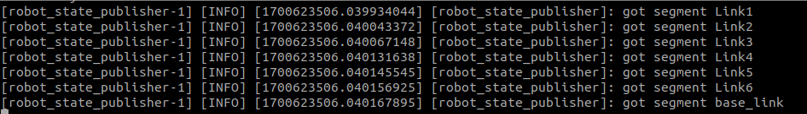
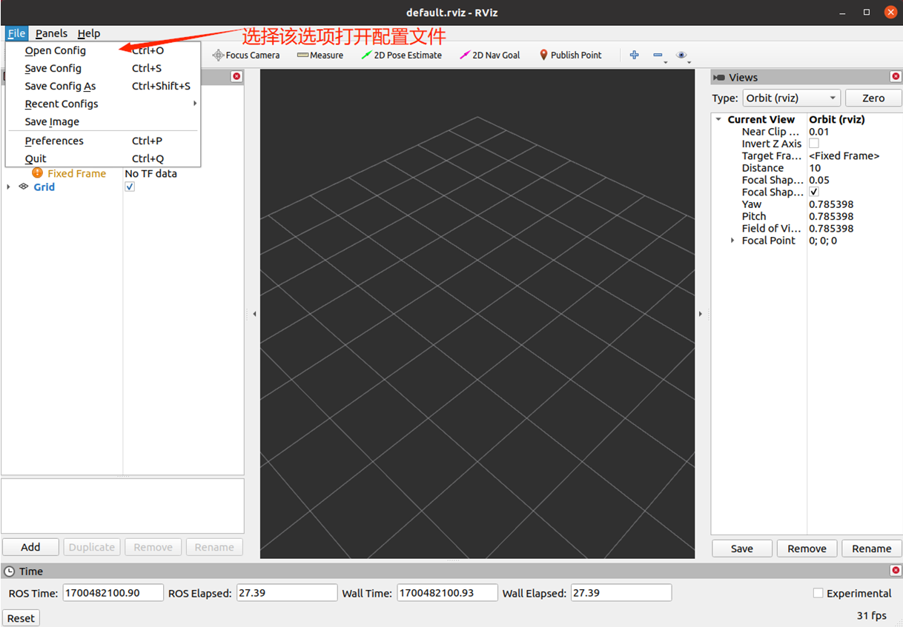
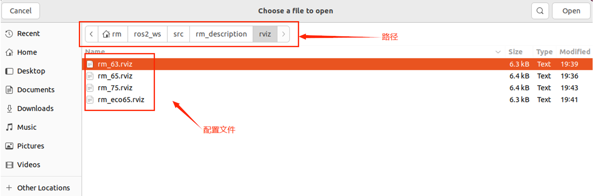
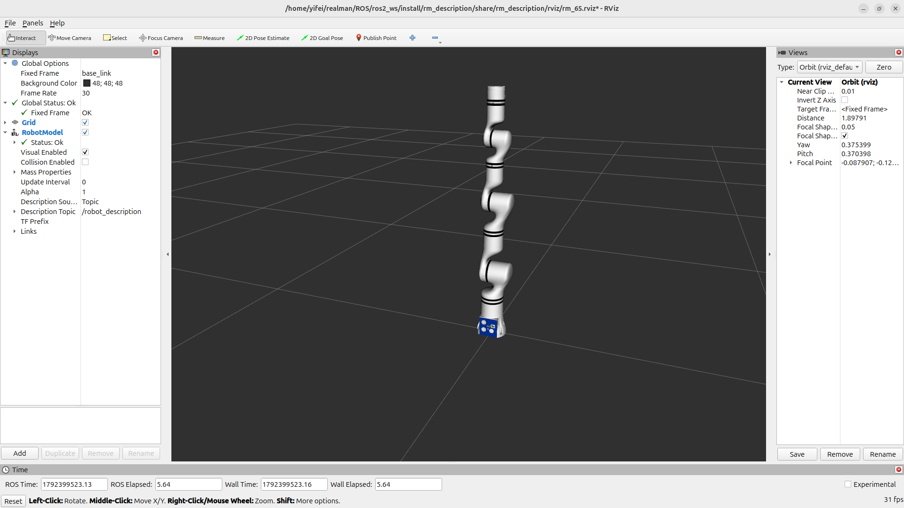

<div align="right">

[简体中文](README_CN.md)|[English](README.md)
 
</div>

<div align="center">

# RealMan Robot rm_description User Manual V1.7

RealMan Intelligent Technology (Beijing) Co., Ltd. 

Revision History:

|No.	  | Date   |	Comment |
| :---: | :----: | :---:   |
|V1.0	  | 2024-2-19 | Draft |
|V1.1	  | 2024-7-3 | Amend(Add GEN72 adapter files) |
|V1.2	  | 2024-9-11 | Amend(Add ECO63 adapter files) |
|V1.3 	| 2024-12-25 | Amend(Add 63, 65, 75, ECO65 six-axis force adapter files and 63, 65, 75, ECO63, ECO65 integrated six-axis force adapter files) |
|V1.4   | 2025-4-7 | Amend(Add GEN72_II adapter files) |
|V1.5   | 2025-11-13 | Amend(Add RML63_III adapter files) |
|V1.6   | 2026-4-16 | Amend(Add ECO62 and RX75 adapter files) |
|V1.7   | 2026-8-11 | Amend(Add the unified model-description launch entry and retain the 21 model/variant entries as compatibility wrappers) |

</div>

## Launch examples

After building and sourcing the workspace, display an RM65 model with integrated force sensing:

```bash
# Model preview for simulation, generation 3, or older generation 4 software (GUI joint controls)
ros2 launch rm_description rm_description.launch.py \
  arm_type:=65-6fb use_rviz:=true use_joint_state_publisher_gui:=true

# Real-robot state display (generation 4 controller software > 1.0.5; start rm_driver first)
ros2 launch rm_description rm_description.launch.py \
  arm_type:=65-6fb use_rviz:=true
```

Generation 4 controller software 1.0.6 and later names the former `6fb` end link `6f`. This standalone display does not query controller generation: keep `65-6fb` to select the same model. Real-robot display uses joint states from the driver without enabling the GUI joint-state publisher. See the [generation-specific model table](../rm_bringup/README.md#unified-launch-entry).


## Content
* 1.[rm_description Package Description](#rm_description_Package_Description)
* 2.[rm_description Package Use](#rm_description_Package_Use)
* 3.[rm_description Package Architecture Description](#rm_description_Package_Architecture_Description)
* 3.1[Overview of Package Files](#Overview_of_Package_Files)
* 4.[rm_description Topic Description](#rm_description_Topic_Description)

## rm_description_Package_Description
rm_description is a function package for displaying the robot model and TF transformation. Through this package, we can realize the linkage effect between a virtual robotic arm in a computer and a real robot arm in reality. In the moveit2 control, we also need the support of this package. This package is introduced in detail in the following aspects.  
* 1.Package use.
* 2.Package architecture description.
* 3.Package topic description.
Through the introduction of the three parts, it can help you:
* 1.Understand the package use.
* 2.Familiar with the file structure and function of the package.
* 3.Familiar with the topic related to the package for easy development and use.
Source code address:https://github.com/RealManRobot/ros2_rm_robot.git.
## rm_description_Package_Use
Model selection defaults to `model:=auto`: variants with matching assets use colored GLB,
while other variants use STL. Select `model:=stl` for the original appearance, or
`model:=glb` to require GLB. See the [supported arm_type values](../rm_bringup/README.md#unified-launch-entry)
and [MoveIt model selection](../rm_bringup/README.md#model-selection).

The generic entry is recommended:

```bash
ros2 launch rm_description rm_description.launch.py \
  arm_type:=65-6fb use_rviz:=true use_joint_state_publisher_gui:=true
```

It explicitly supports the 21 catalogued model/variant combinations. `model` accepts
`auto/stl/glb` and defaults to `auto`; forcing `glb` for a variant without matching assets
fails before nodes start. Other common arguments include `use_sim_time`, `joint_states_topic`,
`use_joint_state_bridge`, `use_joint_state_publisher_gui`, and `use_rviz`.
RX75 also accepts `left_xyz/left_rpy/right_xyz/right_rpy`. Invalid
combinations fail before nodes are started. The historical
`*_display.launch.py` commands below are compatibility wrappers and also default to
`model:=auto`. Other original arguments and defaults are retained. Append `model:=stl`
to display the original STL appearance.

Select the complete model and end-link version directly with `arm_type`.
A bare family selects its standard version; RX75 requires an explicit suffix.

| Argument | Default | Description |
| :--- | :--- | :--- |
| `arm_type` | Required | Complete selector, e.g. `eco65-6fb`; see the [model table](../rm_bringup/README.md#unified-launch-entry) |
| `model` | `auto` | Prefer matching GLB; `stl` uses original STL, `glb` requires GLB |
| `use_sim_time` | `false` | Use the simulation clock |
| `joint_states_topic` | `/joint_states` | Joint-state subscription topic |
| `use_joint_state_bridge` | `auto` | Enable the left/right joint-state bridge automatically for RX75 |
| `use_joint_state_publisher_gui` | `false` | Start the joint-state GUI |
| `use_rviz` | `false` | Start RViz2 |

With `model:=stl`, `eco65-6f` and `eco65-6fb` use the existing `rm_eco65.urdf.xacro`
and select `Link6_6f` and `Link6_6fb`, respectively. Offline expansion confirms that
joints, inertial data, and collision parameters match their corresponding GLB models.

First, after configuring the environment and completing the connection, we can directly start the node and run the rm_description package.
```
rm@rm-desktop:~$ ros2 launch rm_description rm_<arm_type>_display.launch.py
```
The `rm_<arm_type>_display.launch.py` pattern applies to 65, 63, 63_III, 75, eco62, eco63, eco65, gen72, and gen72_II.

The command to start the six-axis force version is currently available for 63, 65, 75, and eco65:
```
rm@rm-desktop:~$ ros2 launch rm_description rm_<arm_type>_6f_display.launch.py
```
The command to start the integrated six-axis force version is currently available for 63, 63_III, 65, 75, eco63, eco65, and rx75:
```
rm@rm-desktop:~$ ros2 launch rm_description rm_<arm_type>_6fb_display.launch.py
```
The command to start the vision-enabled integrated six-axis force version is currently only available for rx75:
```
rm@rm-desktop:~$ ros2 launch rm_description rm_<arm_type>_6fb_v_display.launch.py
```
For example, the launch command of 65 robotic arm:  
```
rm@rm-desktop:~$ ros2 launch rm_description rm_65_display.launch.py
```
The following screen appears in the interface after successful node startup.  

Then we need to launch the rm_driver node.  
```
rm@rm-desktop:~$ ros2 launch rm_driver rm_<arm_type>_driver.launch.py
```
After a successful launch, we can check the state of the robotic arm in rviz2. Run the following command to launch rviz2.  
```
rm@rm-desktop:~$ rviz2
```
Open the robot model with the following configuration.  
  
Find the corresponding configuration file under the rviz folder of the rm_description package.  

After loading, you can see the current state of the robotic arm in the interface of rviz2.  

## rm_description_Package_Architecture_Description
### Overview_of_package_files
The current rm_description package is composed of the following files.  
```
├── CMakeLists.txt                # compilation rule file
├── config                        # legacy controller joint-name configurations
│   ├── joint_names_rm_65_description.yaml
│   └── joint_names_rml_63_description.yaml
├── doc                           # documentation images
│   ├── rm_description1.png
│   ├── rm_description2.png
│   ├── rm_description3.png
│   └── rm_description4.png
├── launch
│   ├── rm_description.launch.py       # unified complete-model launch entry
│   ├── rm_63_6f_display.launch.py  # 63 six-axis force launch file
│   ├── rm_63_6fb_display.launch.py # 63 integrated six-axis force launch file
│   ├── rm_63_display.launch.py     # 63 launch file
│   ├── rm_63_III_6fb_display.launch.py # 63_III integrated six-axis force launch file
│   ├── rm_63_III_display.launch.py     # 63_III launch file
│   ├── rm_65_6f_display.launch.py  # 65 six-axis force launch file
│   ├── rm_65_6fb_display.launch.py # 65 integrated six-axis force launch file
│   ├── rm_65_display.launch.py     # 65 launch file
│   ├── rm_75_6f_display.launch.py  # 75 six-axis force launch file
│   ├── rm_75_6fb_display.launch.py # 75 integrated six-axis force launch file
│   ├── rm_75_display.launch.py     # 75 launch file
│   ├── rm_eco62_display.launch.py  # eco62 launch file
│   ├── rm_eco65_6f_display.launch.py  # eco65 six-axis force launch file
│   ├── rm_eco65_6fb_display.launch.py # eco65 integrated six-axis force launch file
│   ├── rm_eco65_display.launch.py  # eco65 launch file
│   ├── rm_eco63_6fb_display.launch.py # eco63 integrated six-axis force launch file
│   ├── rm_eco63_display.launch.py  # eco63 launch file
│   ├── rm_gen72_II_display.launch.py # gen72_II launch file
│   ├── rm_gen72_display.launch.py  # gen72 launch file
│   ├── rm_rx75_6fb_display.launch.py   # RX75-6FB dual-arm launch file
│   └── rm_rx75_6fb_v_display.launch.py # RX75-6FB-V dual-arm launch file
├── meshes                       # model file storage folder
│   ├── glb                      # matching colored assets preferred by model:=auto
│   ├── rm_63_arm                 #63 robotic arm model file storage folder
│   │   ├── base_link.STL
│   │   ├── link1.STL
│   │   ├── link2.STL
│   │   ├── link3.STL
│   │   ├── link4.STL
│   │   ├── link5.STL
│   │   ├── link6_6f.STL
│   │   ├── link6_6fb.STL
│   │   └── link6.STL
│   ├── rm_65_arm                 #65 robotic arm model file storage folder
│   │   ├── base_link.STL
│   │   ├── link1.STL
│   │   ├── link2.STL
│   │   ├── link3.STL
│   │   ├── link4.STL
│   │   ├── link5.STL
│   │   ├── link6_6f.STL
│   │   ├── link6_6fb.STL
│   │   └── link6.STL
│   ├── rm_75_arm                 #75 robotic arm model file storage folder
│   │   ├── base_link.STL
│   │   ├── link1.STL
│   │   ├── link2.STL
│   │   ├── link3.STL
│   │   ├── link4.STL
│   │   ├── link5.STL
│   │   ├── link6.STL
│   │   ├── link7_6f.STL
│   │   ├── link7_6fb.STL
│   │   └── link7.STL
│   ├── rm_eco62_arm                 #eco62 robotic arm model file storage folder
│   │   ├── base_link.STL
│   │   ├── Link1.STL
│   │   ├── Link2.STL
│   │   ├── Link3.STL
│   │   ├── Link4.STL
│   │   ├── Link5.STL
│   │   └── Link6.STL
│   ├── rm_eco65_arm                 #eco65 robotic arm model file storage folder
│   │   ├── baselink.STL
│   │   ├── Link1.STL
│   │   ├── Link2.STL
│   │   ├── Link3.STL
│   │   ├── Link4.STL
│   │   ├── Link5.STL
│   │   ├── Link6_6f.STL
│   │   ├── Link6_6fb.STL
│   │   └── Link6.STL
│   ├── rm_eco63_arm                 #eco63 robotic arm model file storage folder
│   │   ├── base_link.STL
│   │   ├── Link1.STL
│   │   ├── Link2.STL
│   │   ├── Link3.STL
│   │   ├── Link4.STL
│   │   ├── Link5.STL
│   │   ├── Link6_6fb.STL
│   │   └── Link6.STL
│   ├── rm_gen72_II_arm              #gen72_II robotic arm model file storage folder
│   │   ├── base_link.STL
│   │   ├── Link1.STL
│   │   ├── Link2.STL
│   │   ├── Link3.STL
│   │   ├── Link4.STL
│   │   ├── Link5.STL
│   │   ├── Link6.STL
│   │   └── Link7.STL
│   ├── rm_gen72_arm                 #gen72 robotic arm model file storage folder
│   │   ├── base_link.STL
│   │   ├── Link1.STL
│   │   ├── Link2.STL
│   │   ├── Link3.STL
│   │   ├── Link4.STL
│   │   ├── Link5.STL
│   │   ├── Link6.STL
│   │   └── Link7.STL
│   └── rm_rx75_arm                  #RX75 dual-arm model file storage folder
│       ├── rm_rx75_left_arm
│       │   ├── base_link.STL
│       │   ├── Link1.STL
│       │   ├── Link2L.STL
│       │   ├── Link3.STL
│       │   ├── Link4.STL
│       │   ├── Link5.STL
│       │   ├── Link6.STL
│       │   ├── Link7.STL
│       │   └── Link8.STL
│       ├── rm_rx75_left_arm_v
│       │   ├── base_link.STL
│       │   ├── Link1.STL
│       │   ├── Link2.STL
│       │   ├── Link3.STL
│       │   ├── Link4.STL
│       │   ├── Link5.STL
│       │   ├── Link6.STL
│       │   ├── Link7.STL
│       │   └── Link8.STL
│       ├── rm_rx75_right_arm
│       │   ├── base_link.STL
│       │   ├── Link1.STL
│       │   ├── Link2.STL
│       │   ├── Link3.STL
│       │   ├── Link4.STL
│       │   ├── Link5.STL
│       │   ├── Link6.STL
│       │   ├── Link7.STL
│       │   └── Link8.STL
│       └── rm_rx75_right_arm_v
│           ├── base_link.STL
│           ├── Link1.STL
│           ├── Link2.STL
│           ├── Link3.STL
│           ├── Link4.STL
│           ├── Link5.STL
│           ├── Link6.STL
│           ├── Link7.STL
│           └── Link8.STL
├── package.xml
├── README_CN.md
├── README.md
├── rm_description               # Python launch support module
│   ├── __init__.py
│   ├── legacy_display.py         # legacy display-wrapper definitions
│   └── variant_catalog.py        # complete arm_type catalog, aliases, and STL/GLB mapping
├── rviz                               #rviz2 configuration file storage folder
│   ├── rm_63.rviz
│   ├── rm_65.rviz
│   ├── rm_75.rviz
│   ├── rm_eco62.rviz
│   ├── rm_eco65.rviz
│   ├── rm_eco63.rviz
│   ├── rm_gen72.rviz
│   └── rm_rx75.rviz
├── scripts
│   └── dual_arm_joint_state_bridge.py  # RX75 dual-arm joint state bridge
└── urdf
    ├── display_arm.rviz
    ├── rm_eco62.csv
    ├── rm_eco62_gazebo.urdf            #eco62 gazebo simulation urdf description file
    ├── rm_eco62_gazebo.urdf.xacro      #eco62 gazebo simulation xacro description file
    ├── rm_eco62.urdf                   #eco62 urdf description file
    ├── rm_eco62.urdf.xacro             #eco62 xacro description file
    ├── rm_65_6f.urdf                   #65 six-axis force urdf description file
    ├── rm_65_6fb.urdf                  #65 integrated six-axis force urdf description file
    ├── rm_65_description.csv
    ├── rm_65_gazebo.urdf               #65 gazebo simulation urdf description file
    ├── rm_65_gazebo.urdf.xacro         #65 gazebo simulation xacro description file
    ├── rm_65.urdf                      #65 urdf description file
    ├── rm_65.urdf.xacro                #65 xacro description file
    ├── rm_75_6f.urdf                   #75 six-axis force urdf description file
    ├── rm_75_6fb.urdf                  #75 integrated six-axis force urdf description file
    ├── rm_75_description.csv
    ├── rm_75_gazebo.urdf               #75 gazebo simulation urdf description file
    ├── rm_75_gazebo.urdf.xacro         #75 gazebo simulation xacro description file
    ├── rm_75.urdf                      #75 urdf description file
    ├── rm_75.urdf.xacro                #75 xacro description file
    ├── rm_eco65_6f.urdf                #eco65 six-axis force urdf description file
    ├── rm_eco65_6fb.urdf               #eco65 integrated six-axis force urdf description file 
    ├── rm_eco65.csv
    ├── rm_eco65_gazebo.urdf            #eco65 gazebo simulation urdf description file
    ├── rm_eco65_gazebo.urdf.xacro      #eco65 gazebo simulation xacro description file
    ├── rm_eco65.urdf                   #eco65 urdf description file
    ├── rm_eco65.urdf.xacro             #eco65 xacro description file
    ├── rm_eco63_6fb.urdf               #eco63 integrated six-axis force urdf description file
    ├── rm_eco63.csv
    ├── rm_eco63_gazebo.urdf            #eco63 gazebo simulation urdf description file
    ├── rm_eco63_gazebo.urdf.xacro      #eco63 gazebo simulation xacro description file
    ├── rm_eco63.urdf                   #eco63 urdf description file
    ├── rm_eco63.urdf.xacro             #eco63 xacro description file
    ├── rm_gen72.csv
    ├── rm_gen72_II.urdf                #gen72_II urdf description file
    ├── rm_gen72_II_gazebo.urdf         #gen72_II gazebo simulation urdf description file
    ├── rm_gen72_gazebo.urdf            #gen72 gazebo simulation urdf description file
    ├── rm_gen72.urdf                   #gen72 urdf description file
    ├── rm_rx75-6fb.urdf.xacro          #RX75-6FB dual-arm xacro description file
    ├── rm_rx75-6fb_v.urdf.xacro        #RX75-6FB-V dual-arm xacro description file
    ├── rm_rx75l-6fb.csv
    ├── rm_rx75l-6fb.urdf               #RX75-6FB left-arm urdf description file
    ├── rm_rx75l-6fb_v.csv
    ├── rm_rx75l-6fb_v.urdf             #RX75-6FB-V left-arm urdf description file
    ├── rm_rx75r-6fb.csv
    ├── rm_rx75r-6fb.urdf               #RX75-6FB right-arm urdf description file
    ├── rm_rx75r-6fb_v.csv
    ├── rm_rx75r-6fb_v.urdf             #RX75-6FB-V right-arm urdf description file
    ├── rml_63_6f.urdf                  #63 six-axis force urdf description file
    ├── rml_63_6fb.urdf                 #63 integrated six-axis force urdf description file
    ├── rml_63_description.csv
    ├── rml_63_gazebo.urdf              #63 gazebo simulation urdf description file
    ├── rml_63_gazebo.urdf.xacro        #63 gazebo simulation xacro description file
    ├── rml_63.urdf                     #63 urdf description file
    └── rml_63.urdf.xacro               #63 xacro description file
```
## rm_description_Topic_Description
The following is the topic description of the package.  
```
  Subscribers:
    /joint_states: sensor_msgs/msg/JointState
    /parameter_events: rcl_interfaces/msg/ParameterEvent
  Publishers:
    /parameter_events: rcl_interfaces/msg/ParameterEvent
    /robot_description: std_msgs/msg/String
    /rosout: rcl_interfaces/msg/Log
    /tf: tf2_msgs/msg/TFMessage
    /tf_static: tf2_msgs/msg/TFMessage
  Service Servers:
    /robot_state_publisher/describe_parameters: rcl_interfaces/srv/DescribeParameters
    /robot_state_publisher/get_parameter_types: rcl_interfaces/srv/GetParameterTypes
    /robot_state_publisher/get_parameters: rcl_interfaces/srv/GetParameters
    /robot_state_publisher/list_parameters: rcl_interfaces/srv/ListParameters
    /robot_state_publisher/set_parameters: rcl_interfaces/srv/SetParameters
    /robot_state_publisher/set_parameters_atomically: rcl_interfaces/srv/SetParametersAtomically
  Service Clients:

  Action Servers:

  Action Clients:
```
We mainly focus on the following topics.  
Subscribers: represents the topics it subscribes to, where /joint_states represents the current state of the robotic arm, which is published by our rm_driver package when running so that the model in rviz moves according to the actual state of the robotic arm.  
Publishers: represents the topics it currently publishes, where the most important published topics are /tf and /tf_static, which describe the coordinate transformation relationship between the joints of the robotic arm, namely TF transformation.  
There are relatively few remaining topics and service use scenarios and you can learn by yourself.
