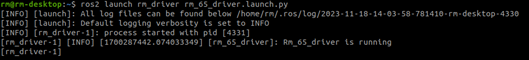
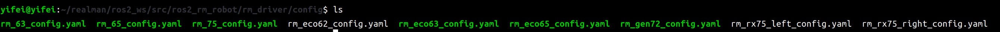
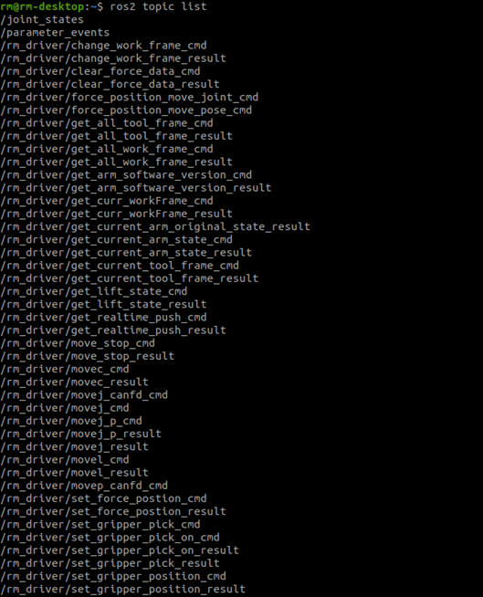
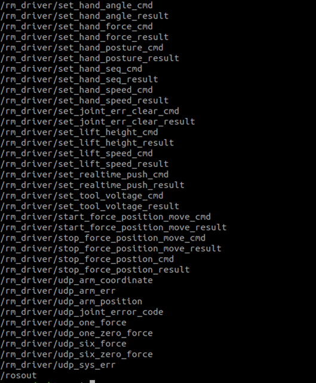

<div align="right">
 
[简体中文](README_CN.md)|[English](README.md)

</div>

<div align="center">

# 睿尔曼机器人rm_driver使用说明书V1.7.1
 
睿尔曼智能科技（北京）有限公司 
文件修订记录：

| 版本号| 时间   | 备注  | 
| :---: | :-----: | :---: |
|V1.0    |2024-2-7  |拟制 |
|V1.1    |2024-7-8  |修订(添加GEN72适配文件) |
|V1.2    |2024-9-10 |修订(添加ECO63适配文件) |
|V1.2.1  |2024-10-31|修订(添加灵巧手高速适配) |
|V1.3    |2024-12-25|修订(添加UDP上报适配) |
|V1.4    |2024-12-25|修订(添加UDP上报适配) |
|V1.5    |2025-05-29|修订（适配四代控制器、添加版本查询接口、添加笛卡尔空间直线偏移运动接口、添加Modbus接口、添加轨迹列表接口详见话题接口说明文档）|
|V1.6    |2025-11-13|修订（添加UDP所有基础使能配置）|
|V1.7    |2026-4-16 |修订（添加ECO62、RX75适配文件）|
|V1.7.1    |2026-8-14 |修订（统一启动、Modbus超时、端点独占与信号安全清理）|

</div>

## 启动示例

构建并 source 工作区后，以一体化六维力 RM65 为例：

```bash
# 连接真实机械臂（三、四代均使用基础型号）
ros2 launch rm_driver rm_driver.launch.py \
  arm_type:=65

# 注：四代控制器软件自 1.0.6 起将原 6fb 末端统一命名为 6f。
# rm_driver 和 rm_control 只需指定基础型号，如 63、65、75、eco63 或 eco65，无需末端后缀。
# 此处仅提示三、四代的命名差异，启动参数保持一致。
```

本包用于真机链路；Gazebo 使用仿真控制器。`arm_type` 按基础型号选择配置。完整型号见[三、四代型号表](../rm_bringup/README_CN.md#统一启动入口)。

## 目录
* 1.[rm_driver功能包说明](#rm_driver功能包说明)
* 2.[rm_driver功能包使用](#rm_driver功能包使用)
* 2.1[功能包基础使用](#功能包基础使用)
* 2.2[功能包进阶使用](#功能包进阶使用)
* 3.[rm_driver功能包架构说明](#rm_driver功能包架构说明)
* 3.1[功能包文件总览](#功能包文件总览)
* 4.[rm_driver话题说明](#rm_driver话题说明)

## rm_driver功能包说明
rm_driver功能包在机械臂ROS2功能包中是十分重要的，该功能包实现了通过ROS与机械臂进行通信控制机械臂的功能，在下文中将通过以下几个方面详细介绍该功能包。  
* 1.功能包使用。  
* 2.功能包架构说明。  
* 3.功能包话题说明。

通过这三部分内容的介绍可以帮助大家：  
* 1.了解该功能包的使用。  
* 2.熟悉功能包中的文件构成及作用。  
* 3.熟悉功能包相关的话题，方便开发和使用  
## rm_driver功能包使用
### 功能包基础使用
推荐使用统一入口：

```bash
ros2 launch rm_driver rm_driver.launch.py arm_type:=65
```

| 参数 | 默认值 | 说明 |
| :--- | :--- | :--- |
| `arm_type` | 无，必须指定 | 型号或带末端后缀的型号，例如 `65`、`65-6fb`、`rx75`；支持值见[型号表](../rm_bringup/README_CN.md)，按基础型号选择驱动配置 |
| `driver_config` | `auto` | 单臂 driver YAML 路径；`auto` 使用型号默认配置 |
| `left_driver_config` | `auto` | 仅 RX75：左臂 driver YAML 路径；`auto` 使用默认左臂配置 |
| `right_driver_config` | `auto` | 仅 RX75：右臂 driver YAML 路径；`auto` 使用默认右臂配置 |

无效的型号/配置组合或不存在的YAML会在driver节点启动前报错。
RX75会启动两个带namespace的driver节点。原有8个按型号启动的文件
保留为兼容wrapper。

driver在SDK初始化前对 `arm_ip:tcp_port` 取主机本地非阻塞锁。
同一端点的第二个进程以非零状态退出，不同端点可并存。SIGINT、
SIGTERM和SIGHUP汇合到同一个幂等SDK清理路径。该清理是尽力而为，
对SIGKILL、掉电或崩溃并不能替代控制器watchdog和硬件急停。

Modbus V1.7.1消息变更：

- `RS485params.timeout`：三代Modbus RTU超时，单位100 ms；非正数使用
  兼容默认值 `5`（500 ms）。
- `Modbustcpmasterinfo.timeout`：三代Modbus TCP超时，单位ms；
  非正数使用兼容默认值 `2000` ms。
- 四代SDK查询路径不提供超时值，查询结果回填 `timeout=0`。

首先配置好环境完成连接后我们可以通过以下命令直接启动节点，控制机械臂。  
当前的控制基于我们没有改变过机械臂的IP即当前机械臂的IP仍为192.168.1.18。  
rm@rm-desktop:~$ ros2 launch rm_driver rm_<arm_type>_driver.launch.py  
在实际使用时需要将以上的<arm_type>更换为实际的机械臂型号，可选择的机械臂型号有65、63、eco65、eco63、eco62、75、gen72、rx75。  
底层驱动启动成功后，将显示以下画面。  
  
### 功能包进阶使用
当我们的机械臂IP被改变后我们的启动指令就失效了，再直接使用如上指令就无法成功连接到机械臂了，我们可以通过修改如下配置文件，重新建立连接。  
该配置文件位于我们的rm_driver功能包下的config文件夹下。  
  
其配置文件内容如下：

```
rm_driver:   
  ros__parameters:  
    #robot param  
    arm_ip: "192.168.1.18"        #设置TCP连接时的IP  
    tcp_port: 8080                #设置TCP连接时的端口  
    
    arm_type: "RM_65"             #机械臂型号设置    
    arm_dof: 6                    #机械臂自由度设置  

    udp_ip: "192.168.1.10"        #设置udp主动上报IP  
    udp_cycle: 5                  #udp主动上报周期，需要是5的倍数  
    udp_port: 8089                #设置udp主动上报端口  
    udp_force_coordinate: 0       #设置系统受力时六维力的基准坐标，0为传感器坐标系 1为当前工作坐标系 2为当前工具坐标系
    udp_hand: false               #设置灵巧手udp主动上报使能
    udp_plus_base: false          #设置末端设备基础信息udp主动上报使能
    udp_plus_state: false         #设置末端设备实时信息udp主动上报使能
    udp_joint_speed_state: true   #设置关节速度主动上报
    udp_lift_state: true          #设置升降关节主动上报
    udp_expand_state: false       #设置拓展关节主动上报
    udp_arm_current_status: true  #设置机械臂状态主动上报
    udp_aloha_state: true         #aloha状态主动上报
    trajectory_mode: 0            #设置高跟随模式下，支持多种模式，0-完全透传模式、1-曲线拟合模式、2-滤波模式
    radio: 0                      #设置曲线拟合模式下平滑系数（范围0-100）或者滤波模式下的滤波参数（范围0-1000），数值越大表示平滑效果越好
    arm_joints: ["joint1", "joint2", "joint3", "joint4", "joint5", "joint6"]
```

其中主要有以下几个参数。
* arm_ip：改参数代表机械臂当前的IP
* tcp_port：设置TCP连接时的端口。
* arm_type：该参数代表机械臂当前的型号，可以选择的参数有RM_65（65系列）、RM_eco65（ECO65系列）、RM_eco63（ECO63系列）、RM_eco62（ECO62系列）、RML_63（63系列）、RM_75（75系列，RX75双臂配置文件中左右臂均使用该型号）、GEN_72（GEN72系列）。
* arm_dof: 机械臂自由度设置。6为6自由度，7为7自由度。
* udp_ip: 设置udp主动上报目标IP。
* udp_cycle：udp主动上报周期，需要是5的倍数。
* udp_port：设置udp主动上报端口。
* udp_hand: false               #设置灵巧手udp主动上报使能
* udp_plus_base: false          #设置末端设备基础信息udp主动上报使能
* udp_plus_state: false         #设置末端设备实时信息udp主动上报使能
* udp_joint_speed_state: true   #设置关节速度主动上报
* udp_lift_state: true          #设置升降关节主动上报
* udp_expand_state: false       #设置拓展关节主动上报
* udp_arm_current_status: true  #设置机械臂状态主动上报
* udp_aloha_state: true         #aloha状态主动上报
* udp_force_coordinate：设置系统受力时六维力的基准坐标，0为传感器坐标系（原始数据） 1为当前工作坐标系 2为当前工具坐标系。
* trajectory_mode：设置高跟随模式下，支持多种模式，0-完全透传模式、1-曲线拟合模式、2-滤波模式
* radio：设置曲线拟合模式下平滑系数（范围0-100）或者滤波模式下的滤波参数（范围0-1000），数值越大表示平滑效果越好
* 在实际使用时，我们选择对应的launch文件启动时会自动选择正确的型号，若有特殊要求可在此处进行相应的参数修改，修改之后需要在工作空间目录下进行重新编译，之后修改的配置才会生效。
* 在工作空间目录运行colcon build指令。

```
rm@rm-desktop: ~/ros2_ws$ colcon build
```

* 编译成功后可按如上指令进行功能包启动。
## rm_driver功能包架构说明
### 功能包文件总览
当前rm_driver功能包的文件构成如下。

```
├── CMakeLists.txt                 #编译规则文件
├── config                         #配置文件夹
│   ├── rm_63_config.yaml          #63配置文件
│   ├── rm_65_config.yaml          #65配置文件
│   ├── rm_75_config.yaml          #75配置文件
│   ├── rm_eco62_config.yaml       #eco62配置文件
│   ├── rm_eco65_config.yaml       #eco65配置文件
│   ├── rm_eco63_config.yaml       #eco63配置文件
│   ├── rm_gen72_config.yaml       #gen72配置文件
│   ├── rm_rx75_left_config.yaml   #RX75左臂配置文件
│   └── rm_rx75_right_config.yaml  #RX75右臂配置文件
├── doc
│   ├── Description of Function Expansion for Realman Robotic Arm ROS Driver Package.md
│   ├── RealMan Robotic Arm rm_driver Topic Detailed Description (ROS2).md
│   ├── rm_driver1.png
│   ├── rm_driver2.png
│   ├── rm_driver3.png
│   ├── rm_driver4.png
│   ├── rm_driver5.png
│   ├── rm_driver6.png
│   ├── rm_driver7.png
│   ├── rm_driver8.png
│   ├── rm_driver9.png
│   ├── rm_driver10.png
│   ├── rm_driver11.png
│   ├── rm_driver12.png
│   ├── rm_driver13.png
│   ├── 睿尔曼机械臂ROS2rm_driver话题详细说明.md
│   └── 睿尔曼机械臂ROS驱动包功能拓展说明.md
├── include                        #依赖头文件文件夹
│   └── rm_driver/
│       ├── rm_define.h                               # SDK 数据类型、枚举和常量
│       ├── rm_driver.h                               # ROS 2 驱动节点、回调及运行状态定义
│       ├── rm_interface.h                            # SDK C 接口声明
│       ├── rm_interface_global.h                     # SDK 接口导出宏
│       ├── rm_service.h                              # SDK C++ RM_Service 类接口
│       └── rm_version.h                              # SDK 版本定义
├── launch
│   ├── rm_driver.launch.py        #统一driver启动入口
│   ├── rm_63_driver.launch.py     #63启动文件
│   ├── rm_65_driver.launch.py     #65启动文件
│   ├── rm_75_driver.launch.py     #75启动文件
│   ├── rm_eco62_driver.launch.py  #eco62启动文件
│   ├── rm_eco65_driver.launch.py  #eco65启动文件
│   ├── rm_eco63_driver.launch.py  #eco63启动文件
│   ├── rm_gen72_driver.launch.py  #gen72启动文件
│   └── rm_rx75_driver.launch.py   #RX75启动文件
├── lib
│   ├── lib_install.sh                                # 按主机架构选择并安装 SDK 库
│   ├── libapi_cpp.so                                 # CMake 链接并随包安装的 SDK 动态库
│   ├── linux_arm64_c++_v1.1.7/
│   │   └── libapi_cpp.so                             # ARM64 SDK 动态库
│   └── linux_x86_c++_v1.1.7/
│       └── libapi_cpp.so                             # x86_64 SDK 动态库
├── package.xml                                           #依赖声明文件
├── README_CN.md
├── README.md
└── src
    └── rm_driver.cpp                                     #驱动代码源文件
```

## rm_driver话题说明
rm_driver的话题较多，可以通过如下指令了解其话题信息。

  
主要为套用API实现的一些机械臂本体的功能，其详细介绍和使用在此不详细展开，可以通过专门的文档《[睿尔曼机械臂ROS2话题详细说明](https://github.com/RealManRobot/ros2_rm_robot/blob/foxy/rm_driver/doc/%E7%9D%BF%E5%B0%94%E6%9B%BC%E6%9C%BA%E6%A2%B0%E8%87%82ROS2rm_driver%E8%AF%9D%E9%A2%98%E8%AF%A6%E7%BB%86%E8%AF%B4%E6%98%8E.md)》进行查看。
