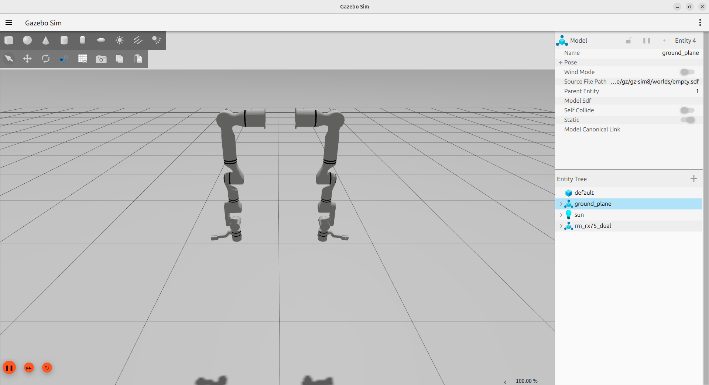
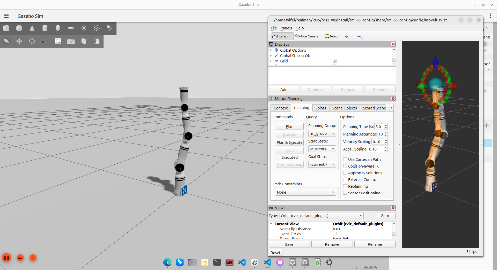

<div align="right">
 
[简体中文](README_CN.md)|[English](README.md)

</div>

<div align="center">

# 睿尔曼机器人rm_gazebo使用说明书V1.7
 
睿尔曼智能科技（北京）有限公司 
文件修订记录：

| 版本号| 时间   | 备注  | 
| :---: | :-----: | :---: |
|V1.0    |2024-2-19  |拟制 |
|V1.1    |2024-7-8   |修订（添加gen72相关适配文件） |
|V1.1.1  |2024-8-13  |修订（添加机械臂型号适配说明） |
|V1.2    |2024-9-10  |修订（添加eco63相关适配文件） |
|V1.3    |2024-12-25 |修订(添加了63、65、75、ECO65的六维力适配文件，以及63、65、75、ECO63、ECO65的一体化六维力适配文件) |
|V1.4    |2025-4-3 |修订(添加了Gen72_II型适配文件) |
|V1.5    |2025-11-13 |修订(添加了RML63_III型适配文件) |
|V1.6    |2026-4-16 |修订(添加ECO62、RX75适配文件，更新Gazebo版本) |
|V1.7    |2026-8-14 |修订(新增 Gazebo Classic统一入口并同步仿真模型) |

</div>

## 启动示例

构建并 source 工作区后，以一体化六维力 RM65 的 Gazebo 仿真为例：

```bash
# 仿真（三代 / 四代均沿用 6fb 模型命名，在使用仿真是目前不专门做三四代的区别）
ros2 launch rm_gazebo rm_gazebo.launch.py \
  arm_type:=65-6fb
```

本包启动 Gazebo 仿真。仿真不连接控制器，也不受控制器软件版本限制；四代软件从 `1.0.6` 起将原 `6fb` 末端命名为 `6f`，仿真同一结构仍使用 `65-6fb`。完整型号见[三、四代型号表](../rm_bringup/README_CN.md#统一启动入口)。

## 目录
* 1.[rm_gazebo功能包说明](#rm_gazebo功能包说明)
* 2.[rm_gazebo功能包运行](#rm_gazebo功能包运行)
* 2.1[控制仿真机械臂](#控制仿真机械臂)
* 3.[rm_gazebo功能包架构说明](#rm_gazebo功能包架构说明)
* 3.1[功能包文件总览](#功能包文件总览)

## rm_gazebo功能包说明
rm_gazebo的主要作用为帮助我们实现机械臂Moveit2规划的仿真功能，我们将在gazebo的仿真环境中搭建一个虚拟机械臂，然后通过Moveit2控制gazebo中的虚拟机械臂。
* 1.功能包使用。
* 2.功能包架构说明。
通过这三部分内容的介绍可以帮助大家：  
* 1.了解该功能包的使用。
* 2.熟悉功能包中的文件构成及作用。

## rm_gazebo功能包运行

推荐使用统一入口：

```bash
ros2 launch rm_gazebo rm_gazebo.launch.py \
  arm_type:=65-6f
```

| 参数 | 默认值 | 说明 |
| :--- | :--- | :--- |
| `arm_type` | 无，必须指定 | 型号与末端版本，例如 `65-6f`、`rx75-6fb` |
| `model` | `auto` | 有配套资源时优先使用 DAE，否则使用 STL；`stl` 切回原网格，`dae` 要求配套 DAE |
| `start_gazebo` | `true` | 是否启动 Gazebo Classic；`false` 时连接已运行的 Gazebo 世界 |
| `use_gazebo_gui` | `true` | 启动 Gazebo 时是否打开图形界面 |
| `clock_topic` | `auto` | ROS 仿真时钟话题；`auto` 使用 `/clock` |
| `joint_states_topic` | `auto` | 当前仅支持 `auto`，按型号选择默认关节状态话题 |
| `use_sim_time` | `true` | 模型状态发布节点是否使用 Gazebo 仿真时钟 |
| `spawn_entity_timeout` | `120` | 等待 Gazebo 实体生成服务的超时时间，单位 s |

有 DAE 资源的 14 个型号/末端组合默认在 Gazebo Classic 和 RViz2 中使用彩色 DAE，其余型号保留 STL。只替换外观，保留原碰撞和物理参数。

实体生成成功后才会启动controller；实体或controller进程失败会请求关闭整套
launch。原有21个Gazebo入口保留为兼容wrapper。

### 控制仿真机械臂
在完成环境安装和功能包安装后，我们可以进行rm_gazebo功能包的运行。  
使用如下指令启动gazebo虚拟空间和虚拟机械臂。
```
rm@rm-desktop:~$ ros2 launch rm_gazebo gazebo_<arm_type>_demo.launch.py
```
启动六维力版本机械臂的命令为（当前支持63、65、75、eco65）：
```
rm@rm-desktop:~$ ros2 launch rm_gazebo gazebo_<arm_type>_6f_demo.launch.py
```
启动一体化六维力版本机械臂的命令为（当前支持63、63_III、65、75、eco63、eco65、rx75）：
```
rm@rm-desktop:~$ ros2 launch rm_gazebo gazebo_<arm_type>_6fb_demo.launch.py
```
启动带视觉方案的六维力版本机械臂的命令为（当前仅支持rx75）：
```
rm@rm-desktop:~$ ros2 launch rm_gazebo gazebo_<arm_type>_6fb_v_demo.launch.py
```
在实际使用时需要将以上的<arm_type>更换为实际的机械臂型号，可选择的机械臂型号有65、63、63_III、75、eco62、eco63、eco65、gen72、gen72_II、rx75。运行成功后将弹出如下界面。  


之后我们使用如下指令启动moveit2控制gazebo中的仿真机械臂。
```
rm@rm-desktop:~$ ros2 launch rm_<arm_type>_config gazebo_moveit_demo.launch.py
```
启动六维力版本机械臂的命令为（当前支持63、65、75、eco65）：
```
rm@rm-desktop:~$ ros2 launch rm_<arm_type>_config gazebo_moveit_demo_6f.launch.py
```
启动一体化六维力版本机械臂的命令为（当前支持63、63_III、65、75、eco63、eco65）：
```
rm@rm-desktop:~$ ros2 launch rm_<arm_type>_config gazebo_moveit_demo_6fb.launch.py
```
在实际使用时需要将以上的<arm_type>更换为实际的机械臂型号，可选择的机械臂型号有65、63、63_III、75、eco62、eco63、eco65、gen72、gen72_II。运行成功后弹出rviz2的控制界面后就可以进行moveit2和gazebo的仿真控制了。


## rm_gazebo功能包架构说明
### 功能包文件总览
当前rm_gazebo功能包的文件构成如下。
```
├── CMakeLists.txt                              #编译规则文件
├── config
│   ├── gazebo_63_6fb_description.urdf.xacro    #RML63一体化六维力gazebo模型描述文件
│   ├── gazebo_63_III_description.urdf.xacro    #RML63_III一体化六维力gazebo模型描述文件
│   ├── gazebo_65_6fb_description.urdf.xacro    #RM65一体化六维力gazebo模型描述文件
│   ├── gazebo_75_6fb_description.urdf.xacro    #RM75一体化六维力gazebo模型描述文件
│   ├── gazebo_eco62_description.urdf.xacro     #ECO62gazebo模型描述文件
│   ├── gazebo_eco63_6fb_description.urdf.xacro #ECO63一体化六维力gazebo模型描述文件
│   ├── gazebo_eco65_6fb_description.urdf.xacro #ECO65一体化六维力gazebo模型描述文件
│   ├── gazebo_63_description.urdf.xacro        #RML63gazebo模型描述文件
│   ├── gazebo_65_description.urdf.xacro        #RM65gazebo模型描述文件
│   ├── gazebo_75_description.urdf.xacro        #RM75gazebo模型描述文件
│   ├── gazebo_eco65_description.urdf.xacro     #ECO65gazebo模型描述文件
│   ├── gazebo_eco63_description.urdf.xacro     #ECO63gazebo模型描述文件
│   ├── gazebo_gen72_description.urdf.xacro     #GEN72gazebo模型描述文件
│   ├── gazebo_gen72_II_description.urdf.xacro  #GEN72_IIgazebo模型描述文件
│   ├── gazebo_rx75_6fb_description.urdf.xacro  #RX75-6FB双臂gazebo模型描述文件
│   ├── gazebo_rx75_6fb_v_description.urdf.xacro  #RX75-6FB-V双臂gazebo模型描述文件
│   └── gazebo_rx75_description.urdf.xacro        #RX75双臂gazebo辅助描述文件
├── doc
│   ├── rm_gazebo1.png
│   └── rm_gazebo2.png
├── include
│   └── rm_gazebo
├── launch
│   ├── rm_gazebo.launch.py                 #统一Gazebo Classic入口
│   ├── gazebo_63_6fb_demo.launch.py       #RML63一体化六维力gazebo启动文件
│   ├── gazebo_63_6f_demo.launch.py        #RML63六维力gazebo启动文件
│   ├── gazebo_63_demo.launch.py           #RML63gazebo启动文件
│   ├── gazebo_63_III_6fb_demo.launch.py   #RML63_III 一体化六维力gazebo启动文件
│   ├── gazebo_63_III_demo.launch.py       #RML63_III gazebo启动文件
│   ├── gazebo_65_6fb_demo.launch.py       #RM65一体化六维力gazebo启动文件
│   ├── gazebo_65_6f_demo.launch.py        #RM65六维力gazebo启动文件
│   ├── gazebo_65_demo.launch.py           #RM65gazebo启动文件
│   ├── gazebo_75_6fb_demo.launch.py       #RM75一体化六维力gazebo启动文件
│   ├── gazebo_75_6f_demo.launch.py        #RM75六维力gazebo启动文件
│   ├── gazebo_75_demo.launch.py           #RM75gazebo启动文件
│   ├── gazebo_eco62_demo.launch.py        #ECO62gazebo启动文件
│   ├── gazebo_eco63_6fb_demo.launch.py    #ECO63一体化六维力gazebo启动文件
│   ├── gazebo_eco63_demo.launch.py        #ECO63gazebo启动文件
│   ├── gazebo_eco65_6fb_demo.launch.py    #ECO65一体化六维力gazebo启动文件
│   ├── gazebo_eco65_6f_demo.launch.py     #ECO65六维力gazebo启动文件
│   ├── gazebo_eco65_demo.launch.py        #ECO65gazebo启动文件
│   ├── gazebo_gen72_demo.launch.py        #GEN72gazebo启动文件
│   ├── gazebo_gen72_II_demo.launch.py     #GEN72_IIgazebo启动文件
│   ├── gazebo_rx75_6fb_demo.launch.py     #RX75-6FB双臂gazebo启动文件
│   ├── gazebo_rx75_6fb_v_demo.launch.py   #RX75-6FB-V双臂gazebo启动文件
│   └── gz_demo_common.py                  #Gazebo公共启动辅助脚本
├── package.xml
├── README_CN.md
└── README.md
```
